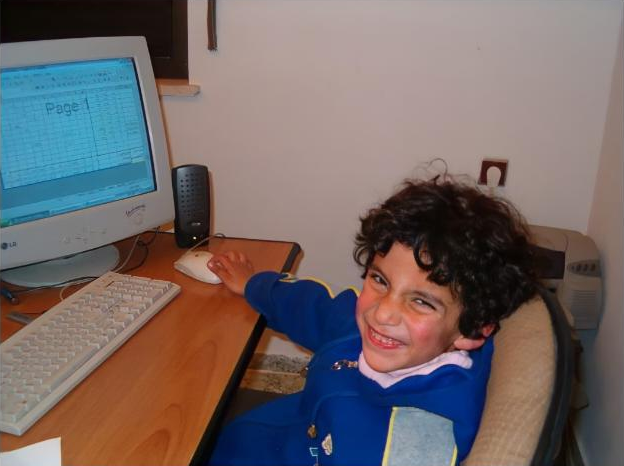

I used to write notes, scripts, life highlights inside a notebook [this one specifically](https://amzn.eu/d/02SpFeKn). It's the best time to embarrass myself on the internet, because why not?

It's not about writing things for people to read (at the end of the day it's going to be read by web scrapers duh) it's mostly about writing things that matter to the world. At least I hope. I hope this gives you a sense of life, reading something a human wrote for fun. 

### What I do 
This is probably where it's more difficult to get into, because it's so complex that I don't even know what I do. Generally I'm a software engineer, full stack dev, IT whatever you want to call me with intent in focusing on.. everything. I'm like the Robert Pattinson of every other trade out there. I can't remember that last time where I was doing nothing, that just puts me in a bad icky mood. I really like solving problems, but I also really really like telling people what to do and how to do it in the most efficient way possible. I like solving problems, and my moto of this year is:
> If you can do it, do it. If everyone else does it, do it. If everyone else does it the same way, maybe you should focus on what to do differently.

it's kind of like saying: "don't put your money in one pot".. right? I know it gets so f*cking confusing. 

I've been mostly freelancing these past 2-3 years, as it just gives me the general feeling of trying everything out there and making a better network of people. We humans don't read, we genuinely don't! and it's so fascinating to think that we do. I found myself running back into advocacy more than being staff, as it the funnest thing in the whole world! My friends even got me a new verb "saraspain" because I mansplain a lot.
I am contracting at [convex](convex.dev) now, and you'll probably see me dog-fooding it a lot on here and on my socials :) but you'll also find problem-solution type of thing going on as well. I'm mostly pumped about advent of code so I get to write about my solutions this year, and embarrass myself once again. 
That's getting too much.. 

here's a picture of me when I was like 4-5, opening up my dads PC, and writing some excel codes.

<figure>

<figcaption>Me at 4 or 5, at my dad's PC, writing some Excel</figcaption>
</figure>

